# Lienzo

**Lienzo** es un launcher liviano para Android TV y Google TV (televisores y decos): una obra de arte de dominio público como fondo, tus apps favoritas en un dock, "Continuar viendo", Entradas (HDMI, AV, TV en vivo), botones del control asignables a cualquier app, reloj con alarma y temporizador, clima y feriados. Paquete `cl.deco.shelf`, licencia MIT.

> **English summary.** Lienzo is a lightweight Android TV launcher (Android 9+, Kotlin, plain Views, no analytics, no Compose/Leanback). It shows a public-domain artwork (or a dynamic colour glow) as wallpaper with a dock of favourite apps, a "Continue watching" row (Watch Next), TV inputs with an HDMI hot-plug notice, fully remappable remote buttons, clock, alarms and timers, weather and public holidays, a screensaver with video, a crash watchdog (safe mode) and a device health notice. It talks only to Open-Meteo, Nager.Date, Wikimedia and GitHub. Updates come from GitHub Releases and are verified before install: SHA-256 plus an identical signing certificate, installed through `PackageInstaller`, always with the system confirmation. Build with `./gradlew :app:assembleDebug`; releases are built and signed by GitHub Actions from encrypted repository secrets when a `vX.Y.Z` tag is pushed (or locally with `tools/release.sh`). UI language: Spanish (Chile) with partial English date formats. Tested on a DIW585 set-top box (Android 12), a TCL Google TV (Android 11) and a Xiaomi Mi Box S (Android 9).

## Capturas

| | |
|---|---|
| 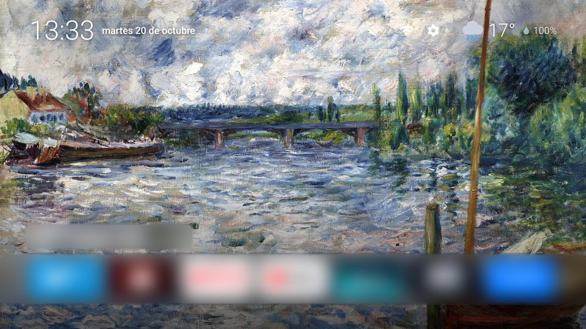 Home con el dock | 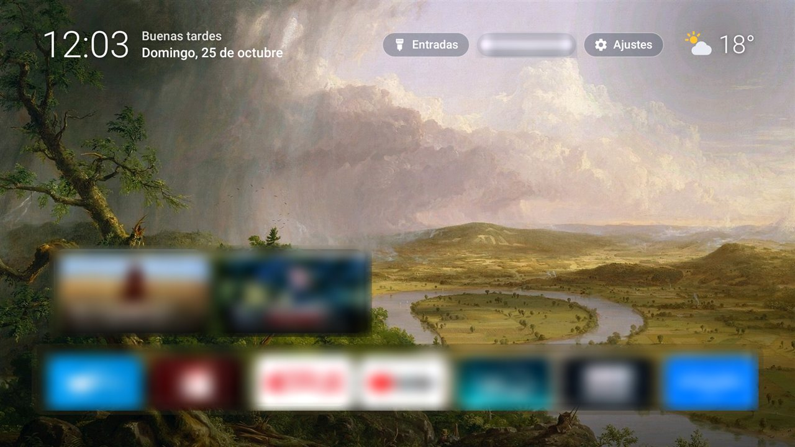 Top Shelf |
| 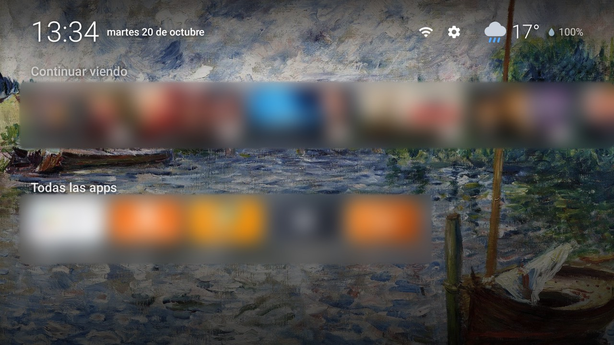 Continuar viendo y todas las apps | 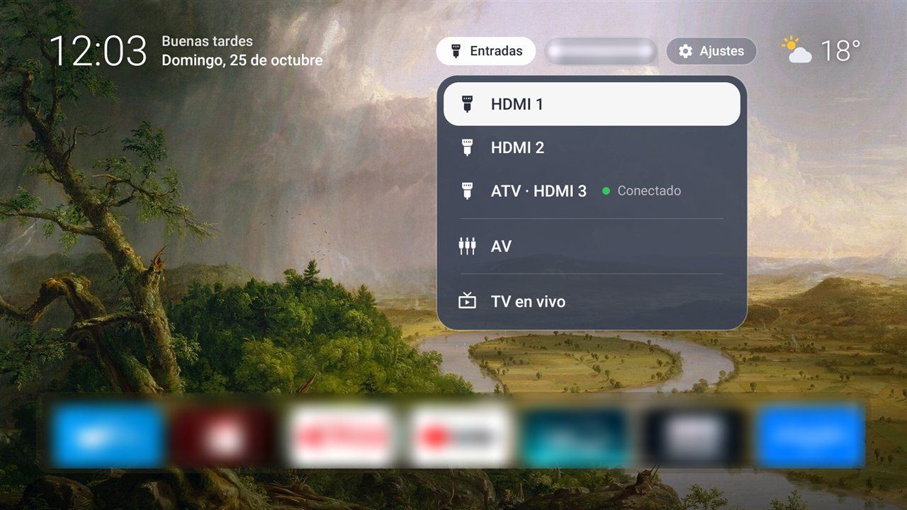 Entradas con estado real |
| 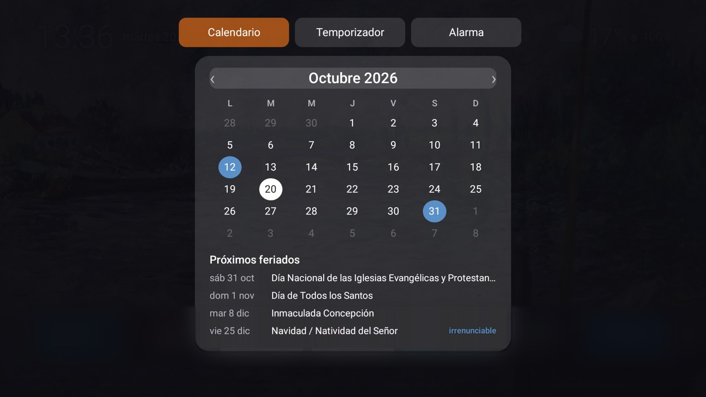 Calendario y feriados | 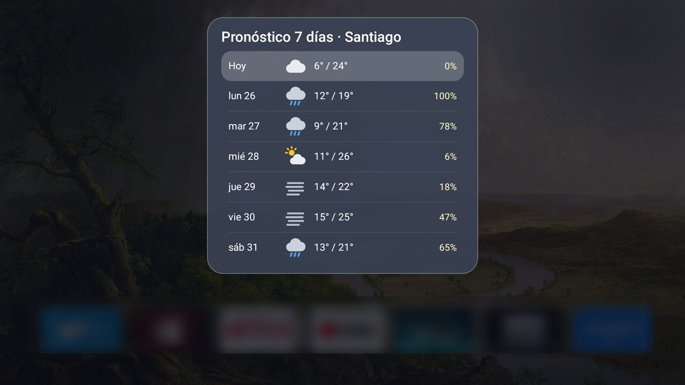 Pronóstico de 7 días |
| 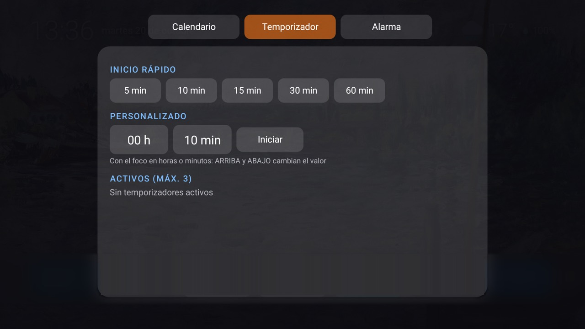 Temporizador | 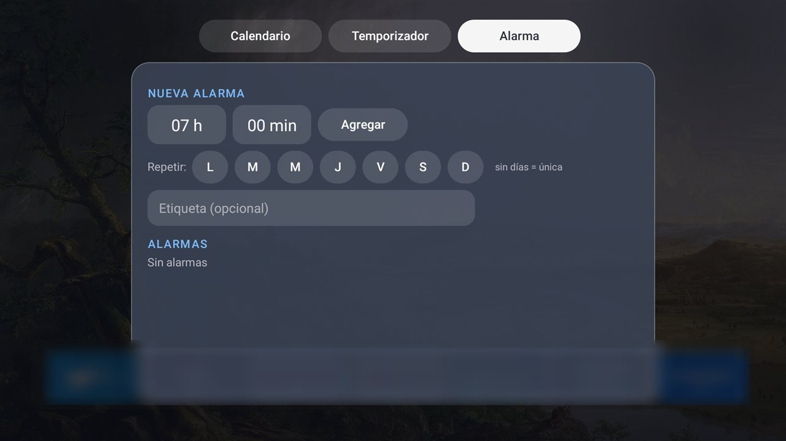 Alarma |
| 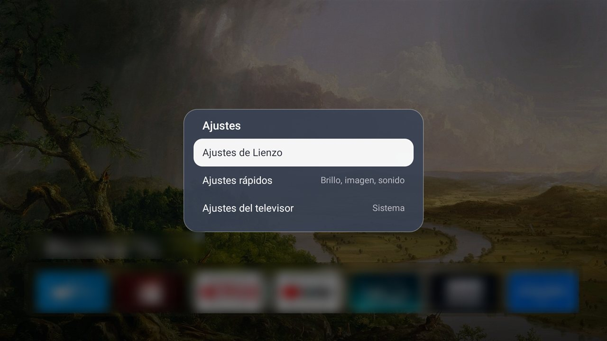 Botón Ajustes: Lienzo, televisor o sistema | 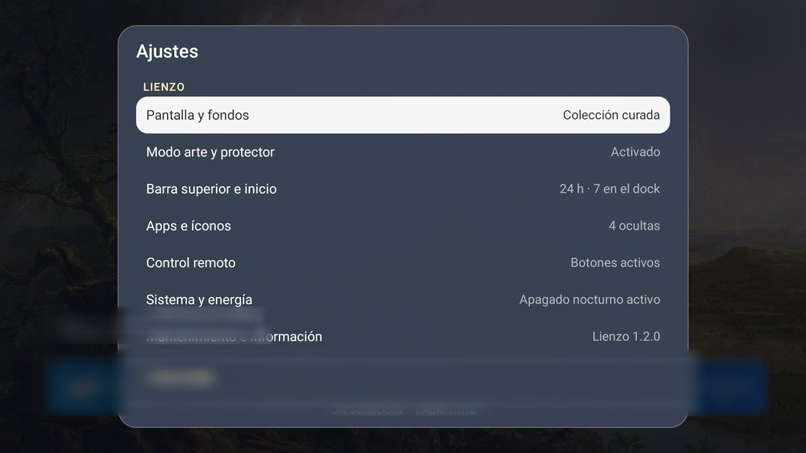 Ajustes de Lienzo |
| 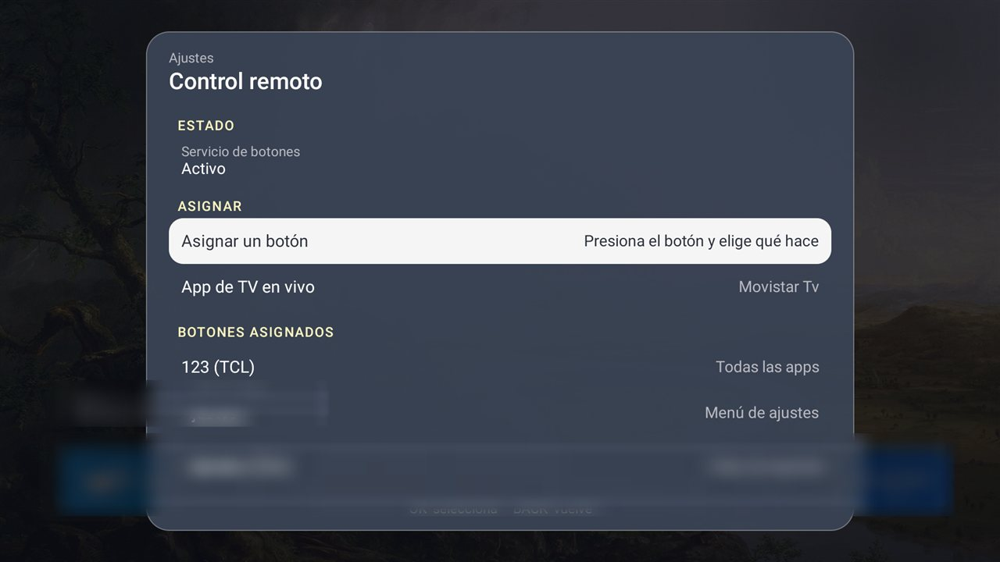 Control remoto asignable | 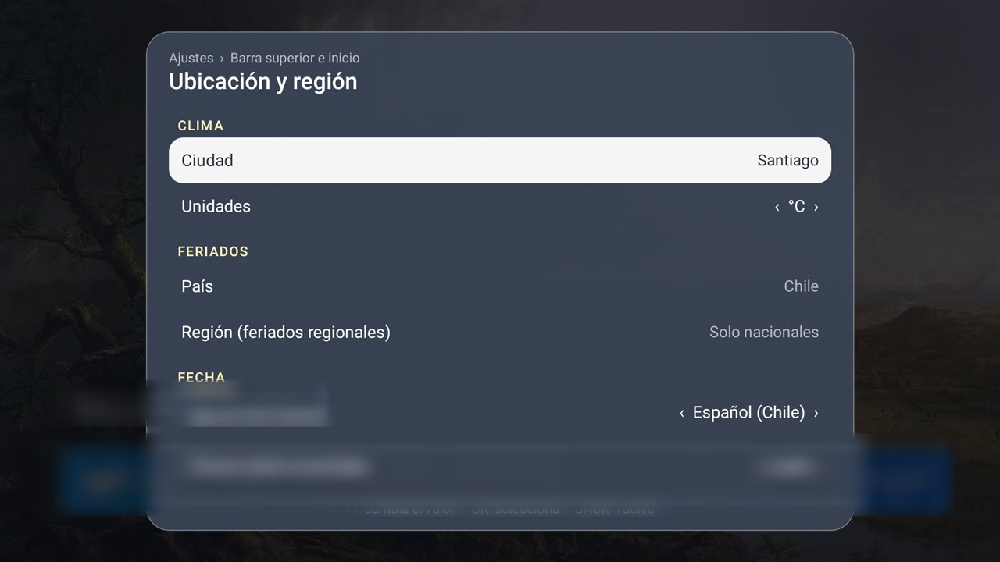 Ubicación y región |
|  Modo arte | |

Capturas en un televisor TCL con Google TV. Tienen desenfocados los íconos de apps, el historial de reproducción y el nombre de la red Wi-Fi.

## Funciones

- Home con 4 a 7 apps favoritas, íconos adaptados u originales, renombrar, ocultar, mover y desinstalar.
- Entradas del televisor (HDMI con nombre personalizado, estado "Conectado" real y nombre HDMI-CEC del equipo, AV, TV en vivo) desde la barra superior o el botón Entradas del control. Aviso al enchufar un equipo en un HDMI, con cualquier app en pantalla.
- Control remoto: cualquier botón (de apps, colores, Guía, Asistente o propios del fabricante) se asigna desde Ajustes > Control remoto a una app, Entradas, Ajustes, TV en vivo, Todas las apps o Modo arte. Funciona con cualquier control vía un servicio de accesibilidad que solo filtra teclas. En el botón de Modo arte, una pulsación corta pasa a la obra siguiente y mantenerlo abre el video.
- Top Shelf y "Continuar viendo" (Watch Next y canales de vista previa, vía `READ_TV_LISTINGS`).
- Fondo de obras de dominio público (117 obras de Wikimedia Commons, incluidas 57 liberadas como CC0 por The Met y la National Gallery of Art), rotación configurable, atenuación nocturna según amanecer y atardecer, colores dinámicos desde la obra. O "Color dinámico": fondo oscuro con un resplandor del color de la app enfocada. Home dos veces rápido pasa a la obra siguiente.
- Mis fondos: importa tus imágenes y videos desde un pendrive USB (sin red, sin ADB), ordenados en colecciones temáticas por carpeta (`Lienzo-<Tema>`), y elige qué colección usan el fondo y el video.
- Modo arte y protector de pantalla con video.
- Configuración sin PC: permisos, servicio de botones, inicio y protector con la depuración por red del propio equipo.
- Reloj, calendario con feriados (por país y región), temporizador y alarma.
- Clima de 7 días con Open-Meteo.
- Modo seguro: un watchdog de crashes arranca en modo mínimo tras 3 fallos en 5 minutos.
- Salud del equipo: aviso "Reiniciar recomendado" con reglas antifatiga y panel con memoria de video (CMA), RAM y tiempo encendido.
- Exportar y restaurar la configuración.
- Prioridad a la reproducción: Lienzo suelta su decodificador de video antes de abrir otra app.
- Actualizador seguro desde GitHub Releases (ver más abajo).

## Requisitos

- Android TV 9 o superior (`minSdk` 28). Probado en un decodificador DIW585 (Android 12), un televisor TCL con Google TV (Android 11) y una Xiaomi Mi Box S MDZ-22-AB (Android 9). Otros equipos no están verificados.
- En Android 9 el launcher de sistema gana aunque se elija otro inicio: "Usar Lienzo como inicio" (Configuración sin PC) lo deshabilita de forma reversible y "Volver al launcher original" lo rehabilita.
- Para el modo sin ADB, un explorador de archivos o una app de descarga en el equipo.

## Instalación

Descarga `Lienzo-X.Y.Z.apk` desde [Releases](https://github.com/Parzval-Net/Lienzo_Launcher/releases).

### Con ADB (recomendada)

Activa la depuración por red en las opciones de desarrollador y ejecuta:

```sh
adb connect <IP-del-equipo>:5555
adb install -r -g Lienzo-X.Y.Z.apk
adb shell pm grant cl.deco.shelf android.permission.READ_TV_LISTINGS
adb shell pm grant cl.deco.shelf android.permission.WRITE_SECURE_SETTINGS   # apagado nocturno de pantalla
adb shell appops set cl.deco.shelf SYSTEM_ALERT_WINDOW allow                # alarma sobre otras apps
adb shell cmd appops set cl.deco.shelf APP_AUTO_START allow                  # TCL: permite que arranque el servicio de botones del control
adb shell settings put secure enabled_accessibility_services cl.deco.shelf/cl.deco.shelf.service.KeyService
```

En televisores TCL, los botones Netflix, Prime Video, YouTube, TCL Channel (Kino TV), Guard (Downloader), Web (Web Video Caster) y TCL Home (Play Store) se reasignan con el servicio de accesibilidad de Lienzo. Sin `APP_AUTO_START` el sistema deja el servicio habilitado pero detenido; Ajustes > Control remoto muestra el estado.

Después abre Lienzo: el asistente de primer inicio guía la elección de Lienzo como pantalla de inicio. Al terminar, desactiva la depuración por red si no la usas.

### Sin PC

Si instalaste el APK con otra app (Downloader, USB), Lienzo puede ejecutar esos mismos comandos contra el propio equipo: activa la depuración por red en las opciones de desarrollador y entra a Ajustes > Mantenimiento e información > Configuración sin PC. La TV pregunta "¿Permitir depuración por USB?": marca "Permitir siempre" y elige Permitir. Desde ahí se conceden los permisos, se activa el servicio de botones, se fija Lienzo como inicio y protector, o se vuelve al launcher original. Lienzo solo ejecuta esos comandos fijos (cliente ADB local portado de Free My TV y OmarchyTV, MIT; ver NOTICE).

### Sin ADB

1. Copia el APK a un pendrive y ábrelo con un explorador de archivos, o súbelo con una app como Send Files to TV, o descárgalo con Downloader desde el enlace del release. Android pide permitir "instalar apps desconocidas" para esa app.
2. Abre Lienzo y sigue el asistente (permiso de Top Shelf, obras, pantalla de inicio).
3. Si Android no ofrece Lienzo como inicio, pulsa Home y elige Lienzo con "Siempre".

Sin ADB todo funciona, salvo el apagado nocturno de pantalla y la alarma sobre otras apps, que necesitan los permisos concedidos por ADB (la alarma abre Lienzo a pantalla completa en su lugar). El video de fondo no viene en el APK: usa Mis fondos para tus propios videos.

### Volver atrás

Desinstala Lienzo desde Ajustes de Android > Aplicaciones, y al pulsar Home elige tu launcher anterior. La desinstalación borra también los fondos importados y los permisos concedidos por ADB.

## Actualizaciones

Lienzo se actualiza desde los releases de este repositorio. Sin servicios ni tareas en segundo plano:

- Consulta `releases/latest` con `HttpURLConnection`, ETag y User-Agent, solo al volver al home, como máximo una vez cada 24 h, nunca con reproducción activa ni en modo arte. También a pedido: Ajustes > Info > "Buscar actualizaciones".
- Si hay un `versionCode` mayor (y el `minSdk` lo permite), aparece el chip "Actualización vX disponible" en la barra superior. Se oculta solo a las 12 h, "Más tarde" lo silencia 24 h y no vuelve antes de 24 h.
- Ajustes > Info > "Actualizaciones automáticas": Buscar y avisar (por defecto) o Desactivadas.

Cómo se protege la instalación:

| Paso | Protección |
|---|---|
| Descarga | Solo https hacia GitHub y su CDN de releases; el APK debe venir de este repositorio. Con progreso y cancelación, solo con espacio suficiente, con tope de tamaño. |
| Integridad | SHA-256 del APK contra el `version.json` del release. Detecta archivos corruptos. |
| Autenticidad | El certificado de firma del APK descargado debe ser **idéntico** al de la app instalada (`getPackageArchiveInfo` con `GET_SIGNING_CERTIFICATES`), además de paquete, `versionCode` anunciado y versión mayor a la instalada. Si algo falla, se aborta y se borra el archivo. Esto es lo que impide instalar un APK alterado: el hash viaja en el mismo release y no basta por sí solo. |
| Instalación | `PackageInstaller` por sesión con confirmación obligatoria del sistema. Nunca hay instalación silenciosa. La primera vez Android pide autorizar "instalar apps desconocidas" para Lienzo y el panel te lleva a esa pantalla. |
| Limpieza | El APK descargado se borra al terminar, al cancelar o si falla. |

La versión 1.0.0 no trae el actualizador: se pasa a 1.1.0 instalando el APK a mano. Si compilas tu propia copia con otra clave, Android rechazará las actualizaciones de este repositorio (firma distinta) y debes cambiar `UpdateRules.REPO` por tu fork.

### Verificar la firma de un release

```sh
apksigner verify --print-certs Lienzo-X.Y.Z.apk
shasum -a 256 -c SHA256SUMS
```

Huella SHA-256 del certificado de release: `7B:EA:3F:BF:E0:CF:1A:F9:D1:E4:58:DE:57:F0:CA:6B:F9:D7:64:77:88:A8:BB:D7:C2:59:C7:60:E2:53:62:2A`

## Privacidad

- Sin analítica, sin cuentas, sin servidores ni puertos abiertos.
- La red se usa solo para: Open-Meteo (clima y búsqueda de ciudades), Nager.Date (feriados), Wikimedia (obras de arte) y GitHub (actualizaciones: `api.github.com`, `github.com` y su CDN de releases). Si desactivas "Actualizaciones automáticas", GitHub solo se consulta cuando lo pides.
- Configuración, favoritas y fondos importados quedan en el almacenamiento de la app.
- Permisos: `INTERNET`, `ACCESS_NETWORK_STATE`, `READ_TV_LISTINGS` y `READ_EPG_DATA` (Continuar viendo), alarmas y arranque, `READ_EXTERNAL_STORAGE` (solo Android 12, para Mis fondos), `REQUEST_INSTALL_PACKAGES` (actualizador), `REQUEST_DELETE_PACKAGES` (desinstalar desde el menú de una app) y los opcionales concedidos por ADB o por Configuración sin PC (`WRITE_SECURE_SETTINGS`, `SYSTEM_ALERT_WINDOW`).
- Servicio de accesibilidad opcional: solo recibe teclas del control (no lee la pantalla) y vigila el estado de los HDMI con la API pública de TV.
- Configuración sin PC se conecta únicamente a `127.0.0.1:5555` (el ADB del propio equipo) y solo cuando lo pides; la llave RSA queda en el almacenamiento privado de la app.

## Compilar desde el código

Requisitos: JDK 21 y Android SDK con la plataforma 35 (`sdk.dir` en `local.properties` o `ANDROID_HOME`).

```sh
./gradlew :app:testDebugUnitTest :app:assembleDebug     # tests JVM y APK debug
./gradlew :app:assembleRelease                          # sin keystore.properties usa la firma debug
```

El APK sale en `app/build/outputs/apk/`. Solo Android Views y RecyclerView: sin Compose, Leanback, Glide, OkHttp ni coroutines (ver `CONTRACTS.md`).

### Firmar uno mismo

La clave de este proyecto no está en el repositorio: vive cifrada en los secretos de GitHub Actions y en el respaldo del mantenedor. Para firmar tus propias compilaciones:

```sh
keytool -genkeypair -v -keystore mi-clave.jks -alias lienzo -keyalg RSA -keysize 4096 -validity 10000
```

Crea `keystore.properties` en la raíz (está en `.gitignore`):

```properties
storeFile=/ruta/absoluta/mi-clave.jks
storePassword=...
keyAlias=lienzo
keyPassword=...
```

Con eso `assembleRelease` firma con tu clave. Toda actualización futura de tu copia debe firmarse con la misma clave. Guárdala fuera de la nube y de git.

### Publicar un release (mantenedor)

Desde cualquier equipo con acceso al repositorio, con el commit ya en `main`:

```sh
git tag -a v1.2.0 -m "Lienzo 1.2.0"
git push origin v1.2.0
```

El workflow `.github/workflows/release.yml` valida que el tag coincida con `versionName` y apunte a `main`, corre los tests, compila y firma con la keystore de los secretos, verifica la firma (rechaza la de debug y exige la huella de `LIENZO_CERT_SHA256`), el paquete y la versión, y crea el release con APK, `version.json` y `SHA256SUMS`. También se puede crear el tag desde la web de GitHub (Releases > Draft a new release > Choose a tag). Las notas salen de la sección de la versión en `CHANGELOG.md`.

Configuración única del repositorio (Settings > Secrets and variables > Actions):

| Nombre | Tipo | Contenido |
|---|---|---|
| `LIENZO_KEYSTORE_BASE64` | Secreto | La keystore en base64 |
| `LIENZO_KEYSTORE_PASSWORD` | Secreto | `storePassword` de `keystore.properties` |
| `LIENZO_KEY_ALIAS` | Secreto | `keyAlias` |
| `LIENZO_KEY_PASSWORD` | Secreto | `keyPassword` |
| `LIENZO_CERT_SHA256` | Variable | Huella SHA-256 del certificado de release (la de "Verificar la firma de un release") |

Alternativa local, con el árbol limpio y `keystore.properties` en la raíz: `tools/release.sh --dry-run` y luego `tools/release.sh`.

## Limitaciones conocidas

- Probado en dos equipos: decodificador DIW585 (Android 12, 2 GB de RAM) y televisor TCL con Google TV (Android 11). Otros equipos y Android 13 o superior no están verificados; la importación de Mis fondos se verificó en Android 12.
- Idioma de la interfaz: español de Chile; el inglés alcanza solo a fechas y unidades.
- El apagado nocturno de pantalla y la alarma sobre otras apps requieren ADB o Configuración sin PC (depuración por red activa).
- Android 12 no permite a una app cerrar otras: "Liberar cachés" solo vacía las cachés de Lienzo; si la memoria de video sigue baja, hay que reiniciar el equipo.
- El video de fondo no se distribuye; se usan tus propios videos (H.264 o H.265, hasta 1080p y 60 fps).
- Open-Meteo gratuito es para uso no comercial.
- El actualizador necesita que Android permita "instalar apps desconocidas" para Lienzo; en algunos firmwares de TV esa pantalla no existe y hay que habilitarla en Seguridad y restricciones.
- Uso personal: instálalo solo en equipos propios y revisa las condiciones de comodato de tu operador.

## Créditos y licencia

MIT, ver [LICENSE](LICENSE). Atribuciones en [NOTICE](NOTICE): Free My TV y OmarchyTV (MIT), obras de dominio público vía Wikimedia Commons, Open-Meteo (CC BY 4.0) y Nager.Date (MIT). Historial de versiones en [CHANGELOG.md](CHANGELOG.md).
